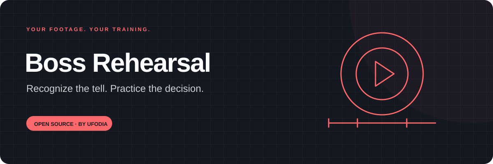
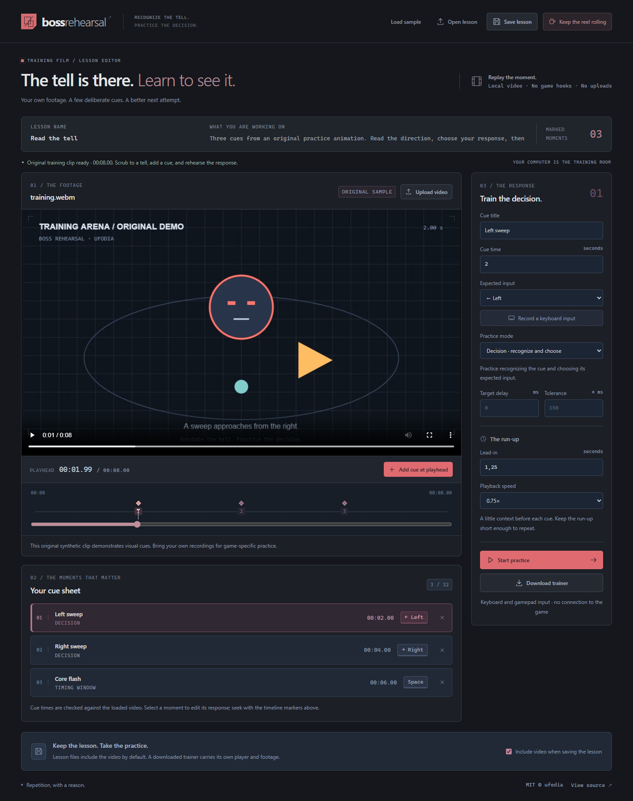
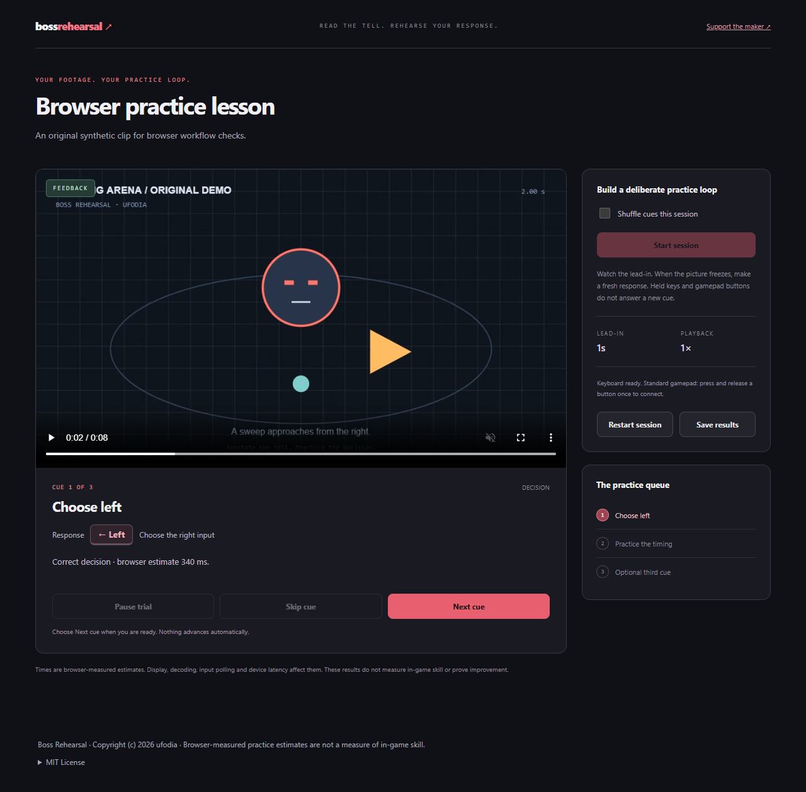

<p align="center">
  
</p>

# Boss Rehearsal

**Turn your own gameplay clip into a focused practice drill.** Mark the moments that matter, choose the expected control, and rehearse the decision before watching the next outcome.

[First drill](docs/guide.md) · [Lesson and scoring reference](docs/reference.md) · [Architecture](docs/architecture.md) · [Privacy](docs/privacy.md) · [MIT license](LICENSE)

[](https://github.com/ufodia/boss-rehearsal/actions/workflows/checks.yml)
[](https://buymeacoffee.com/ufodia)



## Practice the moment you keep missing

A useful tell can disappear inside a long fight recording. Boss Rehearsal lets you isolate it: play a short lead-in, freeze at a cue, respond with a fresh key or gamepad press, then inspect individual feedback before moving on.

Use **decision mode** to practice choosing the expected control, or **timing mode** to practice a response delay and tolerance that you authored. Randomized cue order reduces reliance on the lesson's original sequence.

| Bring                            | Mark                            | Rehearse                                   | Keep                                                     |
| -------------------------------- | ------------------------------- | ------------------------------------------ | -------------------------------------------------------- |
| Your MP4/WebM clip, up to 80 MiB | Cue times and expected controls | Lead-in, frozen cue, response and feedback | Portable lesson, self-contained trainer and session JSON |

## Try the original demo

Install **Node.js 24 LTS** and Git:

```sh
git clone https://github.com/ufodia/boss-rehearsal.git
cd boss-rehearsal
npm ci
npm run dev
```

Open the local address printed by Vite. The included eight-second synthetic training clip loads automatically. Choose **Start practice**, wait for **Start session** to become available, and run its three cues. The [first-drill guide](docs/guide.md) explains authoring and practice states.

The demo is original project material, not footage taken from a commercial game. The tracked source includes its generator. The development command also builds the independent-player runtime before starting the editor.

On Windows, use `npm.cmd` if PowerShell blocks `npm.ps1`.

## What 0.1.0 does

- Loads a local MP4 or WebM video without an account or upload service.
- Lets you manually define cue times, labels and expected keyboard/gamepad controls.
- Supports decision and timing drills with explicit target-delay/tolerance settings.
- Replays a configurable lead-in at the chosen playback rate.
- Freezes and confirms the cue frame before starting the response clock.
- Requires a fresh nonrepeating keypress or gamepad rising edge; a held control cannot answer automatically.
- Shows individual feedback with manual advancement and separate skips.
- Saves/reopens lessons, exports self-contained trainer HTML, and downloads structured session results.

## Read the scores as drill evidence

Decision accuracy, timing-window success and skips are separate measures. Median response latency describes correct decision responses only. A paused, interrupted or not-yet-ready cue is not a scored response.

The tool measures your interaction with this authored video drill. It does not hook into a game, observe its live state or establish that practice improves in-game performance. Physical gamepad compatibility and media-codec support depend on your browser and hardware.

## Share a trainer deliberately

An exported trainer embeds its video and runtime, so it can play without the editor or a CDN. That convenience also means the file can contain the original clip, including private overlays, voice, chat or identifying content visible in it. Review the file before sharing and distribute only footage you have permission to share. See [privacy.md](docs/privacy.md).



_The trainer image uses the project's original synthetic demo. It does not establish physical gamepad or platform-codec compatibility._

## Develop and verify

```sh
npm run verify
npx playwright install --no-shell chromium
npm run test:e2e
```

`verify` runs type checking, unit tests and the complete build, including the standalone trainer. Generated runtime output is ignored by Git; its source and build scripts are tracked.

| Documentation                                     | Purpose                                                     |
| ------------------------------------------------- | ----------------------------------------------------------- |
| [Authoring and practice guide](docs/guide.md)     | Build cues, run a drill, handle interruptions and export    |
| [Lesson and scoring reference](docs/reference.md) | Saved fields, input rules, timing and score semantics       |
| [Architecture](docs/architecture.md)              | Media readiness, engine state and independent player        |
| [Privacy](docs/privacy.md)                        | Local processing and the video inside portable files        |
| [Testing](docs/testing.md)                        | Source/browser checks and manual hardware boundaries        |
| [Restore from GitHub](docs/restore.md)            | Rebuild the application and generated runtime from main     |
| [Static deployment](docs/deployment.md)           | Reproduce the Vite build and committed Vercel configuration |

## Support another useful rehearsal

If a drill helps you understand a moment you kept missing, you can [buy ufodia a coffee](https://buymeacoffee.com/ufodia). Support is voluntary and helps maintain media handling, input support, tests and authoring tools. Everyone gets the same open-source application.

Read [CONTRIBUTING.md](CONTRIBUTING.md) for changes and reproducible reports, and [SECURITY.md](SECURITY.md) for sensitive findings.

## License

[MIT](LICENSE) · Copyright © 2026 **ufodia**.

Your imported recordings keep their own ownership and redistribution conditions; the application license does not grant rights to other people's footage.
