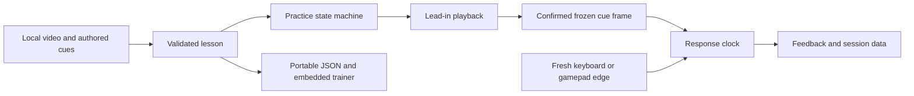

# Architecture and timing boundary

Boss Rehearsal 0.1.0 separates authoring, media readiness, input edges and scoring. It runs in the browser and has no application upload backend or account service.

## Media time is not response time

Cue time identifies a point in the video. The player seeks and plays the lead-in, freezes at that point, and confirms the displayed frame before it starts the response clock. Decode/seek readiness and setup delay therefore do not count as a player's response.

The response clock uses monotonic performance timing. Authored target delay and tolerance are evaluated against that ready state, not a timestamp in the original gameplay recording.

## Input edge boundary

The player accepts a fresh nonrepeating keyboard press or a gamepad rising edge. A held control is state, not a new answer. Input used in one attempt must not silently carry over to the next.

Gamepad mapping depends on browser/hardware behavior. Tests can exercise the edge-detection contract without establishing that every physical controller and platform combination works.

## Attempt state and interruption

An attempt passes through media preparation, lead-in, frozen/ready response, feedback and manual advancement. Skip is separate from answering. Pause, focus loss, hidden tab, seeking and media failure interrupt an active attempt without scoring it; resume retries that cue.

The scoring layer keeps decision accuracy, timing-window outcomes and skips distinct. Median latency uses only correct decision responses. The tool records the authored drill rather than inferring live game state or certifying competitive performance.

## Independent-player build

The tracked player source is bundled as an IIFE and embedded in an exported trainer with the validated lesson and video. Generated runtime is ignored by Git. The normal dev/build workflow recreates it, and development watches player changes so subsequent exports stay aligned with source.

The repository includes the original synthetic-demo generator. That demonstration video is project material, while user-imported recordings keep their own ownership and distribution conditions.

| Source                      | Responsibility                                                                |
| --------------------------- | ----------------------------------------------------------------------------- |
| `src/core.ts`               | Lesson validation, response scoring, shuffle, summary and trainer-HTML export |
| `src/main.ts`               | Video/cue authoring and portable lesson/player downloads                      |
| `src/player.ts`             | Media readiness, fresh input, interruption and feedback lifecycle             |
| `scripts/build-player.mjs`  | Build the independent trainer runtime                                         |
| `scripts/dev.mjs`           | Build/watch the player before starting Vite                                   |
| `scripts/serve-player.mjs`  | Serve one selected exported trainer on loopback                               |
| `scripts/generate-demo.mjs` | Generate the original vector-animation demo                                   |

## Local data boundary

The editor and player use local browser media. Portable lesson files and standalone trainer files may embed the original clip; session JSON is a separate output. The application does not hook a game process, install an anti-cheat integration, run a cloud model or upload recordings.

Saved files are durable only where you keep them. The GitHub repository backs up source and the original demo, not private user lessons or unsaved sessions.
